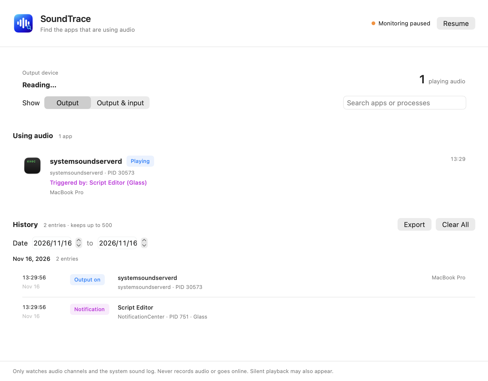

# SoundTrace

[简体中文](README.md) | English

> **macOS only.** SoundTrace is built on macOS Core Audio and the unified system log. It does not support Windows, Linux, or iOS / iPadOS.

Your Mac suddenly plays a "ding" and you have no idea which app did it? SoundTrace shows, in real time, which apps are using audio, and keeps a log of every start, stop, and system sound along with who triggered it.



## Features

- **Live list**: apps currently playing (or recording) audio, with process name, PID, devices in use, and start time.
- **Find the real requester**: system alert sounds are played by `systemsoundserverd`, and notification sounds by Notification Center. SoundTrace reads the system log to show which app actually requested the sound and which sound file was played.
- **History**: grouped by date and filtered by a date range with start and end calendar pickers, both defaulting to today. Search, export to JSON, and clear. Keeps up to 500 entries.
- **Helper process attribution**: audio helper processes of browsers, Electron apps, etc. are grouped under their parent app.
- **English and Simplified Chinese**: the UI follows the system language; other languages fall back to English.

## Requirements

- Mac only, macOS 14.2 or later (requires the Core Audio process object API)
- The package on the Releases page is built for Apple silicon; Intel Macs can build from source

## Installation

Download `SoundTrace-<version>-macOS-arm64.zip` from [Releases](../../releases), unzip it, and drag `音源排查.app` into the Applications folder (Finder shows it as SoundTrace on English systems).

The app is ad-hoc signed. If macOS blocks it on first launch, right-click the app and choose "Open", or allow it under System Settings → Privacy & Security.

## Changing the UI language

There is no in-app language switch. The app follows the system language: Simplified Chinese systems show Chinese, all other languages show English. To set the language for this app only:

1. Open System Settings → General → Language & Region, and click "+" under "Applications" at the bottom.
2. Choose 音源排查 (SoundTrace), then choose "English" or "简体中文".
3. Quit and reopen the app.

Or use Terminal (also requires reopening the app):

```sh
defaults write local.shawn.SoundTrace AppleLanguages '("en")'       # English
defaults write local.shawn.SoundTrace AppleLanguages '("zh-Hans")'  # Simplified Chinese
defaults delete local.shawn.SoundTrace AppleLanguages               # follow the system again
```

## Build from source

Only the Xcode Command Line Tools are needed, not the full Xcode:

```sh
xcode-select --install   # if not installed yet
./build.command          # builds the .app and the zip
./test.command           # runs logic tests (plays a system sound once at zero volume)
```

Build output:

- App: `~/Library/Caches/SoundTraceBuild/音源排查.app`
- Package: `build.nosync/音源排查.zip`

> The app is built outside iCloud Drive because iCloud re-adds extended attributes to files, which breaks the code signature.

## How it works

| Information | Source |
| --- | --- |
| Which processes are playing / recording audio | Core Audio HAL: `kAudioHardwarePropertyProcessObjectList` plus each process's `IsRunningOutput` / `IsRunningInput`, with change listeners |
| Which app a process belongs to | `proc_pidpath` to find the enclosing `.app`, walking up parent processes if needed |
| Who requested a system sound | `log stream` on `systemsoundserverd` request entries (requester PID, sound file) |
| Which app a notification sound belongs to | `log stream` on Notification Center's `Playing notification sound … for <bundle id>` entries |

## Privacy

- Only reads audio channel state and sound requests from the system log. **No recording, no network access.**
- History is stored locally only: `~/Library/Application Support/SoundTrace/history.json`.
- No microphone, accessibility, or other extra permissions required.

## Known limitations

- Sources of system and notification sounds are captured live while monitoring is on; sounds played before monitoring started usually cannot be traced.
- Apps playing silently or at zero volume still appear in the list, because they really do have an open audio output.
- The system log format is an internal macOS detail and may change in future macOS versions.

## Project structure

```
Sources/
  SoundTraceApp.swift, main.swift   App entry point
  ContentView.swift                 UI
  AudioMonitor.swift                Monitoring, event log, history persistence
  CoreAudioReader.swift             Core Audio access
  AppResolver.swift                 Process → app attribution
  SoundLogStream.swift              System sound log parsing
Resources/*.lproj                   English and Simplified Chinese strings
Tests/                              Logic tests and UI render tests
Assets/AppIcon.png                  App icon
Tools/PrepareIcon.swift             Icon processing script
```

## License

[MIT](LICENSE)
