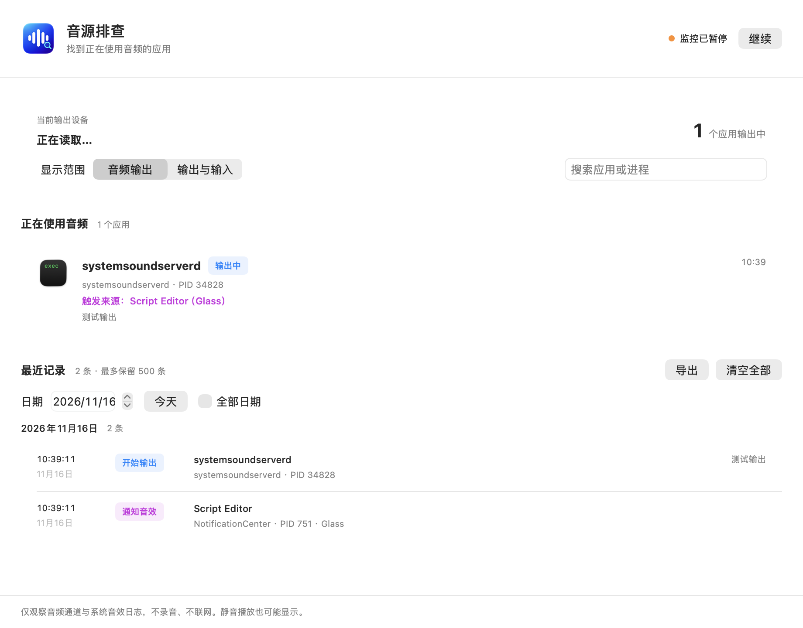

# 音源排查（SoundTrace）

简体中文 | [English](README.en.md)

> **仅支持 macOS。** 本应用基于 macOS 的 Core Audio 与系统日志实现，不支持 Windows、Linux、iOS / iPadOS。

Mac 突然“叮”一声，却不知道是哪个应用发出的？音源排查会实时列出正在使用音频的应用，并记录每一次开始、停止和系统音效的来源。



## 功能

- **实时列表**：显示当前正在输出（或输入）音频的应用、进程、PID、使用的设备和开始时间。
- **追到真正的发起者**：系统提示音由 `systemsoundserverd` 代为播放，通知声音由通知中心代为播放。音源排查会读取系统日志，显示是哪个应用请求了这次声音，以及播放的音效文件。
- **历史记录**：按日期分组，日历选择器默认选中今天，也可以查看全部日期；支持搜索、导出 JSON、清空。最多保留 500 条。
- **辅助进程归属**：浏览器、Electron 等应用的音频辅助进程会归到所属的主应用下。

## 系统要求

- 仅限 Mac，macOS 14.2 及以上（依赖 Core Audio 的进程对象 API）
- Releases 里的安装包为 Apple 芯片版本；Intel Mac 可从源码构建

## 安装

从 [Releases](../../releases) 下载 `音源排查.zip`，解压后拖到“应用程序”文件夹。

应用使用临时签名（ad-hoc），首次打开时如果被系统拦截，请右键点击应用选择“打开”，或在“系统设置 → 隐私与安全性”里允许打开。

## 从源码构建

只需要 Xcode Command Line Tools，不需要完整的 Xcode：

```sh
xcode-select --install   # 如果还没装
./build.command          # 构建 .app 和 zip
./test.command           # 运行逻辑测试（会用静音播放一次系统声音）
```

构建产物：

- 应用：`~/Library/Caches/SoundTraceBuild/音源排查.app`
- 安装包：`build.nosync/音源排查.zip`

> 应用放在 iCloud 之外构建，因为 iCloud 会给文件重新加上扩展属性，导致签名失效。

## 工作原理

| 信息 | 来源 |
| --- | --- |
| 哪些进程在输出/输入音频 | Core Audio HAL：`kAudioHardwarePropertyProcessObjectList` 及每个进程的 `IsRunningOutput` / `IsRunningInput`，并监听变化 |
| 进程属于哪个应用 | `proc_pidpath` 找到所在的 `.app`，找不到时沿父进程向上查找 |
| 系统音效是谁请求的 | `log stream` 读取 `systemsoundserverd` 的请求日志（请求方 PID、音效文件） |
| 通知声音是哪个应用的 | `log stream` 读取通知中心的 `Playing notification sound … for <bundle id>` 日志 |

## 隐私

- 只读取音频通道的状态和系统日志里的音效请求，**不录音、不联网**。
- 历史记录只保存在本机：`~/Library/Application Support/SoundTrace/history.json`。
- 不需要麦克风、辅助功能等额外权限。

## 已知限制

- 系统音效和通知声音的来源需要在监控开启时实时捕获，开启前响过的声音大多查不到来源。
- 以静音或音量为 0 播放的应用也会出现在列表里，因为它们确实打开了音频输出。
- 系统日志的格式属于 macOS 内部实现，未来的系统版本可能变化。

## 项目结构

```
Sources/
  SoundTraceApp.swift, main.swift   应用入口
  ContentView.swift                 界面
  AudioMonitor.swift                监控、事件记录、历史持久化
  CoreAudioReader.swift             Core Audio 读取
  AppResolver.swift                 进程 → 应用的归属
  SoundLogStream.swift              系统音效日志解析
Tests/                              逻辑测试与界面渲染测试
Assets/AppIcon.png                  应用图标
Tools/PrepareIcon.swift             图标处理脚本
```

## 许可

[MIT](LICENSE)
